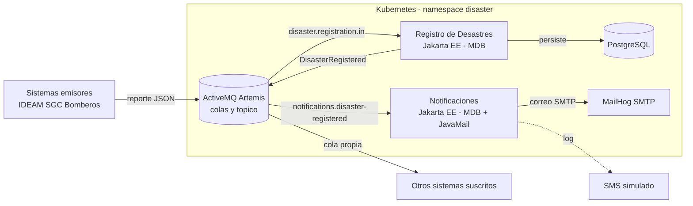
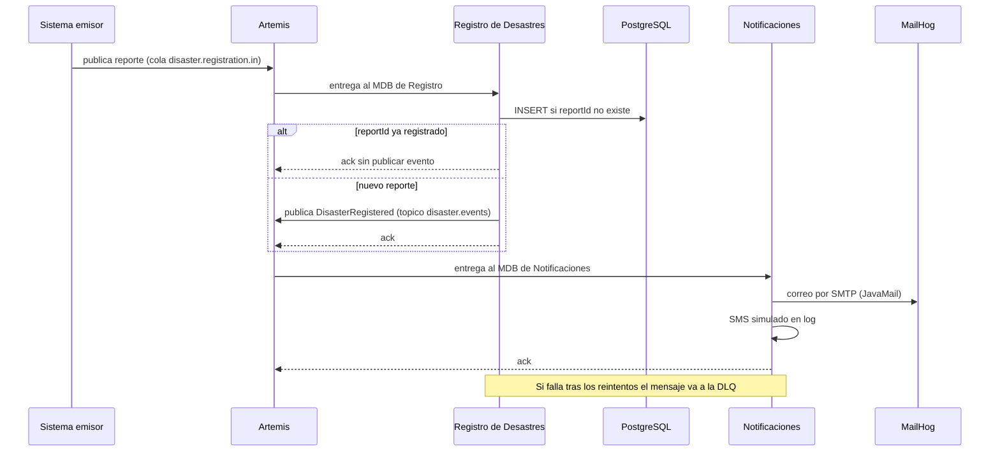

# Arquitectura – Taller 3: registro y notificación asíncrona de desastres

## 1. Contexto y alcance

El sistema recibe de forma asíncrona reportes de desastres enviados por sistemas externos (entidades de emergencias), los registra y notifica a los sistemas y personas interesadas mediante mensajería, correo electrónico o SMS.

- **Estilo elegido:** microservicios con integración orientada a eventos.
- **Tecnologías exigidas por el enunciado:** broker de mensajería (ActiveMQ Artemis, que además habla MQTT), JavaMail, Docker y, por ser microservicios, Kubernetes. El consumo se hace con MDB sobre JMS.
- **Fuera de alcance:** evaluación de daños, personas afectadas, reconstrucción y GIS. Los diferimos porque el taller se valida con un flujo vertical.

## 2. Requisitos arquitectónicamente significativos

### Funcional primario
| ID | Caso de uso |
|---|---|
| CU-1 | Un sistema externo envía un reporte de desastre; el sistema lo registra y publica `DisasterRegistered`; los suscritos y Notificaciones reaccionan. |

### Escenarios de atributos de calidad
| ID | Atributo | Escenario (fuente → estímulo → artefacto → entorno → respuesta → medida) |
|---|---|---|
| QA-1 | Disponibilidad / tolerancia a fallos | Un sistema emisor envía reportes → Registro de Desastres está caído → operación normal → los reportes se conservan en la cola y se procesan al volver el servicio → 0 reportes perdidos. |
| QA-2 | Modificabilidad | Un nuevo sistema quiere recibir los desastres → se agrega una cola enlazada a `disaster.events` → desarrollo → no se modifica ningún servicio existente → cambio de configuración, 0 líneas de código en Registro. |
| QA-3 | Confiabilidad / idempotencia | El broker reentrega un reporte → Registro lo recibe de nuevo → operación normal → no se crea un segundo desastre ni un segundo evento → 100 % de reportes con `reportId` repetido producen un único registro. |
| QA-4 | Rendimiento (latencia) | Llegan 100 reportes en 10 s → carga normal → registro y notificación → 95 % de las notificaciones se emiten en menos de 5 s. *(valor objetivo a validar con medición)* |
| QA-5 | Desacoplamiento del canal | El correo (SMTP) falla → Notificaciones intenta enviar → entorno degradado → el mensaje se reintenta y, agotados los reintentos, pasa a la DLQ sin bloquear otros → 0 mensajes bloqueados. |

### Restricciones
- RC-1: Docker para empaquetar; Kubernetes para el despliegue de microservicios.
- RC-2: el consumo se hace con un MDB (obligatorio).
- RC-3: el correo se envía con JavaMail.

**Diferido con justificación:** la seguridad (autenticación de emisores, cifrado del canal) se pospone porque el taller se valida en un entorno local de desarrollo; las credenciales son de desarrollo y están declaradas como tales.

## 3. Vista de contenedores (C&C)

| Elemento | Responsabilidad |
|---|---|
| Sistema emisor / simulador | Publica el reporte en `disaster.reports`. |
| ActiveMQ Artemis | Transporta reportes y eventos; aísla a emisores, Registro y Notificaciones. |
| Registro de Desastres | Valida, deduplica por `reportId`, persiste y publica `DisasterRegistered`. |
| Notificaciones | Consume el evento y envía correo (JavaMail) y SMS (simulado). |
| PostgreSQL | Fuente de verdad de los desastres registrados. |
| MailHog | Servidor SMTP de pruebas. |

## 4. Vista de comportamiento

## 5. Vista de despliegue

- **Desarrollo:** `docker-compose.yml` levanta Artemis, PostgreSQL y MailHog; los servicios Jakarta se agregan al mismo archivo.
- **Entrega (microservicios):** `k8s/` contiene los manifiestos (StatefulSets para Artemis y PostgreSQL, Deployment para MailHog, ConfigMap con la topología). Cada microservicio se agrega como Deployment + Service. Probado en Docker Desktop: Artemis, PostgreSQL y MailHog quedan `Running`, la topología se carga desde `broker.xml` (incluido el tópico `disaster.events` como MULTICAST) y el Job del simulador publica 5 reportes en `disaster.registration.in`.
- **Advertencia para los Deployments de los servicios:** Kubernetes inyecta variables como `*_PORT=tcp://...` por cada Service. Usar `enableServiceLinks: false` en los pods para no chocar con las variables de configuración propias.
- Ambos usan la misma topología de Artemis (`infra/artemis/broker.xml`).

## 6. Decisiones arquitectónicas

### D-1. Microservicios con integración por eventos
- **Drivers:** QA-1, QA-2, RC-1.
- **Alternativas:** monolito en capas; servicios/tiers en un contenedor Jakarta.
- **Decisión:** dos microservicios, Registro y Notificaciones, que solo se comunican por eventos.
- **Beneficio:** cada servicio se despliega, escala y falla por separado; agregar suscriptores no toca a Registro (QA-2).
- **Costo:** mayor complejidad operativa (broker, dos despliegues, consistencia eventual) y más difícil de depurar que un monolito.

### D-2. Mensajería asíncrona con ActiveMQ Artemis (cola de reportes + tópico de eventos)
- **Drivers:** QA-1, QA-2, QA-5.
- **Alternativas:** RabbitMQ (descartado: su cliente JMS no implementa `Session.setMessageListener`, por lo que no sirve para un MDB; ver D-3); Kafka (retención y reproducción del log, mayor carga operativa y sin JMS); MQTT puro (orientado a dispositivos, pocas garantías de enrutamiento).
- **Decisión:** Artemis con colas durables y mensajes persistentes. Cumple el MDB (JMS nativo) y habla MQTT y AMQP.
- **Beneficio:** JMS nativo, colas por suscriptor sobre un tópico, reintentos y DLQ configurables por destino.
- **Costo:** no hay reproducción histórica de eventos como en Kafka; el broker es un punto de fallo que habría que clusterizar en producción; se aparta del literal "RabbitMQ" del enunciado.
- **Estado:** aceptada.

### D-3. Consumo con MDB sobre JMS (Artemis)
- **Drivers:** RC-2.
- **Alternativas:** RabbitMQ con `rabbitmq-jms`; cliente AMQP directo (no es MDB); Kafka con puente.
- **Evidencia del descarte:** el spike en WildFly 38 con RabbitMQ despliega el MDB y el resource adapter, pero al activar el consumo falla con `UnsupportedOperationException` en `RMQSession.setMessageListener`.
- **Decisión:** MDB sobre Artemis, con pooled connection factory `artemis-remote-cf`.
- **Evidencia de viabilidad (`jms-probe/`, Artemis 2.37.0):** consumo asíncrono con `MessageListener` (5 de 5 reportes), lectura de la cola de suscripción por su nombre completo `disaster.events::notifications.disaster-registered` y paso a `disaster.registration.dlq` tras 5 entregas fallidas.
- **Costo:** el MDB debe validarse dentro de WildFly (la prueba fue con cliente standalone); el literal "RabbitMQ" del enunciado se sustituye por Artemis, que habla MQTT.
- **Estado:** aceptada.

### D-4. Idempotencia por `reportId`
- **Drivers:** QA-3.
- **Decisión:** `reportId` único en la tabla de desastres; si ya existe, se confirma el mensaje sin publicar evento.
- **Costo:** una consulta/restricción por mensaje; un `reportId` mal generado por el emisor haría que se descarten reportes distintos.

### D-5. Reintentos y cola de mensajes fallidos (DLX/DLQ)
- **Drivers:** QA-1, QA-5.
- **Decisión:** `disaster.dlx` con `disaster.registration.dlq` y `notifications.dlq`; las colas de entrada rechazan hacia ellas.
- **Costo:** los mensajes en DLQ requieren monitoreo y reproceso manual.

### D-6. Correo con JavaMail hacia MailHog; SMS simulado
- **Drivers:** RC-3, QA-5.
- **Decisión:** el correo se envía por SMTP real a MailHog; el SMS se registra en log.
- **Costo:** el SMS no se prueba contra un proveedor real.

### D-7. Persistencia en PostgreSQL por servicio
- **Decisión:** solo Registro accede a la base de datos; Notificaciones no comparte esquema.
- **Costo:** si Notificaciones necesita datos adicionales debe recibirlos en el evento.

## 7. Riesgos y puntos de sensibilidad

| ID | Riesgo | Mitigación |
|---|---|---|
| R-1 | El MDB sobre Artemis no funciona en WildFly con el pooled connection factory remoto. | Probar el MDB temprano; usar el subsistema de mensajería embebido de WildFly como alternativa. |
| R-2 | Registro cae después de persistir y antes de publicar el evento; el desastre queda sin notificar. | Publicar con confirmaciones y reprocesar; patrón outbox como mejora si se justifica. |
| R-3 | Un solo nodo de Artemis es punto único de fallo. | Aceptado en el taller; clúster en un entorno real. |
| R-4 | Credenciales de desarrollo en los manifiestos. | Declarado como diferido (seguridad). |
| R-5 | Un evento que llega a `notifications.dlq` no se reprocesa automáticamente. | Aceptado en el taller; en un entorno real, monitorear la DLQ y reinyectar los mensajes. |

## 8. Trazabilidad

| Escenario | Decisión | Elemento | Evidencia |
|---|---|---|---|
| QA-1 | D-1, D-2, D-5 | Artemis, colas durables | Registro detenido mientras el simulador publica 5 reportes: esperan en la cola y se registran al volver (0 perdidos). |
| QA-2 | D-1, D-2 | `disaster.events` + cola por suscriptor | Pendiente de prueba: agregar una cola al tópico y verificar recepción. |
| QA-3 | D-4 | Registro, PostgreSQL | Simulador con `--duplicate`: el mismo `reportId` enviado 2 veces deja 1 fila, 1 evento y 1 correo. |
| QA-4 | D-2 | Artemis, servicios | Carga de 100 reportes (ver sección 9): p95 de 1,9 s hasta la publicación del evento. |
| QA-5 | D-5, D-6 | Notificaciones, DLQ | MailHog apagado: 5 intentos de envío fallidos y el evento pasa a `notifications.dlq` sin bloquear otros. |

## 9. Resultados de las pruebas

Entorno: Docker Compose en un equipo de desarrollo, Artemis 2.37.0, WildFly 38, PostgreSQL 16, MailHog. Simulador con IDs de reporte nuevos en cada ejecución.

### QA-4 – carga de 100 reportes (100 ms entre reportes)

| Medida | Antes del lote (`LIMIT 1` cada 2 s) | Con lote de 50 por ciclo (`e9b5e14`) |
|---|---|---|
| Reporte → evento publicado, p50 | 58,0 s | 1,07 s |
| Reporte → evento publicado, p95 | 108,8 s | 1,91 s |
| Reporte → evento publicado, máximo | 114,2 s | 2,01 s |
| Último correo respecto al último reporte | 76,5 s después (solo 54 de 100 correos a los 60 s) | 1,5 s después |
| Reportes / eventos / correos | 100 / 100 / 59 al corte de la medición | 100 / 100 / 100, sin duplicados |

El escenario QA-4 (95 % de las notificaciones en menos de 5 s) se cumple en esta carga. La medición cubre la latencia hasta la publicación del evento y el tiempo total hasta el último correo; no se midió la latencia individual de cada correo. Es una sola ejecución en un equipo local, por lo que sirve como evidencia de orden de magnitud y no como medición estadística.

**Causa del incumplimiento inicial:** el publicador del outbox corría cada 2 s y publicaba un evento por ciclo (`LIMIT 1`). Se corrigió publicando hasta 50 eventos por ciclo.

### Pruebas de fallo

| Prueba | Resultado |
|---|---|
| `reportId` duplicado | 1 fila, 1 evento, 1 correo. |
| MailHog apagado | 5 fallos de envío y el evento va a `notifications.dlq`. El mensaje queda en la DLQ y no se reenvía solo al volver MailHog (requiere reproceso manual, ver R-5). |
| Registro apagado mientras llegan 5 reportes | Los reportes esperan en `disaster.registration.in` y se registran al volver el servicio. |
