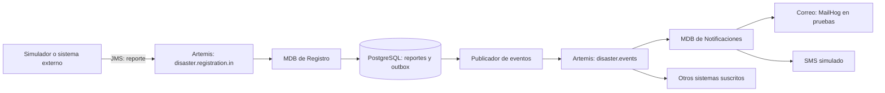

# Diseño arquitectónico del módulo de gestión de desastres

## 1. Propósito

El módulo recibe reportes de desastres de forma asíncrona, los valida y registra, y notifica a los sistemas suscritos. La mensajería permite procesar la recepción, el registro y las notificaciones de forma independiente.

## 2. Vista de componentes

## 3. Flujo de procesamiento

1. El simulador o un sistema externo publica el reporte como `TextMessage` en `disaster.registration.in`.
2. El MDB de Registro consume el mensaje, valida el JSON y registra el reporte en PostgreSQL.
3. Registro usa `reportId` para reconocer reentregas y evitar duplicar el reporte.
4. En la misma transacción de base de datos, guarda el evento pendiente en `event_outbox`.
5. El publicador consulta el outbox por lotes y publica los eventos en el tópico `disaster.events`.
6. El MDB de Notificaciones consume su cola de suscripción y envía el correo a MailHog en pruebas. El SMS queda simulado.
7. Otros sistemas pueden suscribirse al tópico con su propia cola.

Los formatos JSON y los nombres de los destinos están descritos en [Contratos de mensajería](contracts.md).

## 4. Responsabilidad de los componentes

| Componente | Responsabilidad |
|---|---|
| Sistemas emisores y simulador | Publicar reportes sin esperar a que Registro los procese. |
| ActiveMQ Artemis | Mantener las colas y el tópico, entregar mensajes y aplicar reintentos y DLQ. |
| MDB de Registro | Recibir, validar y procesar reportes de forma asíncrona. |
| PostgreSQL | Guardar reportes y eventos pendientes en el outbox. |
| Publicador del outbox | Publicar los eventos pendientes por lotes. |
| MDB de Notificaciones | Consumir eventos y activar los canales de notificación. |
| MailHog | Recibir y permitir inspeccionar los correos del entorno de pruebas. |
| Canal SMS | Simular el envío de mensajes de texto. |

## 5. Decisiones de diseño

- **Mensajería asíncrona:** los emisores no necesitan esperar a que Registro complete el trabajo.
- **MDB en WildFly:** Registro y Notificaciones consumen mensajes con listeners administrados por el servidor.
- **Cola para reportes y tópico para eventos:** Registro consume cada reporte de la cola; los eventos pueden llegar a varios sistemas suscritos.
- **Idempotencia por `reportId`:** una reentrega del mismo reporte no crea otro registro.
- **Outbox transaccional:** el reporte y su evento pendiente se guardan juntos en PostgreSQL. Si el broker no está disponible, el evento permanece pendiente para otro intento.

## 6. Manejo de fallos y límites

Artemis realiza hasta cinco entregas, con dos segundos entre intentos. Si el procesamiento sigue fallando, mueve el mensaje a la DLQ correspondiente. En las pruebas, los reportes que llegan mientras Registro está apagado permanecen en cola y se procesan cuando el servicio vuelve.

Los eventos pendientes del outbox se vuelven a intentar. Los mensajes que llegan a `notifications.dlq` requieren revisión y reproceso manual, según la limitación documentada en [Arquitectura](arquitectura.md).

El correo se verifica con MailHog y el SMS está simulado; esta versión no integra un proveedor real de SMS.

## 7. Despliegue y validación

El entorno local usa Docker Compose. La prueba en Kubernetes despliega Artemis, PostgreSQL, Registro, Notificaciones y MailHog. Los resultados de las pruebas están documentados en [Arquitectura](arquitectura.md).